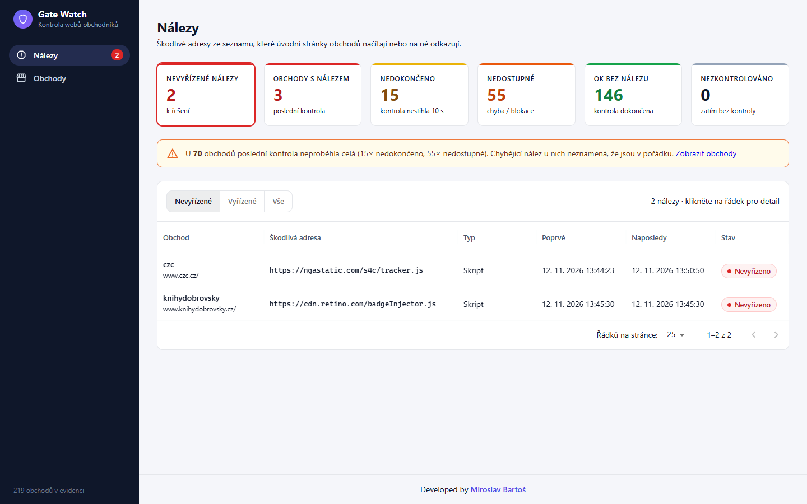
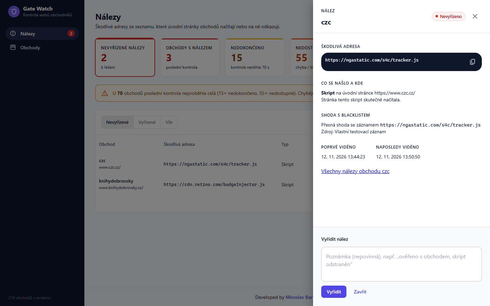
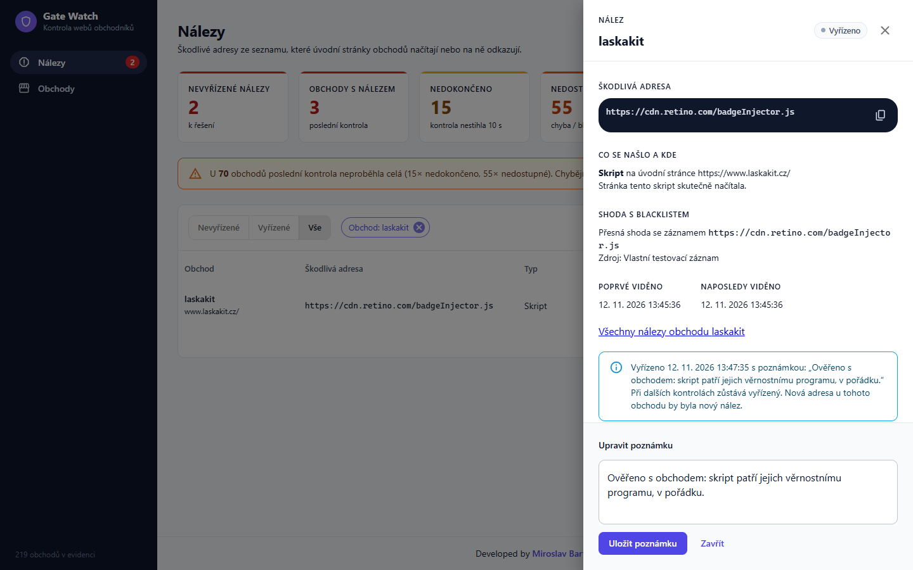
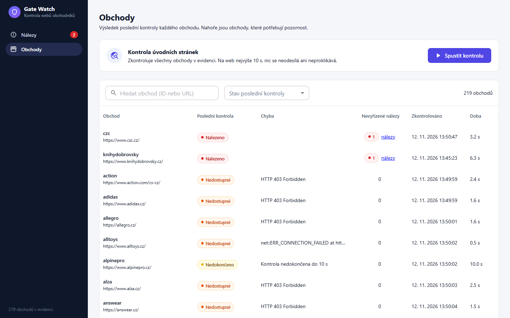
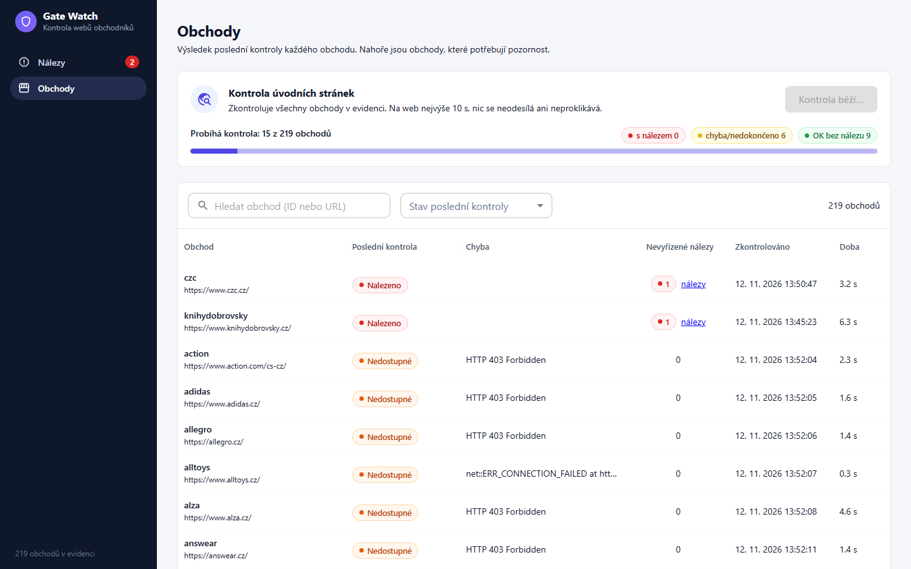
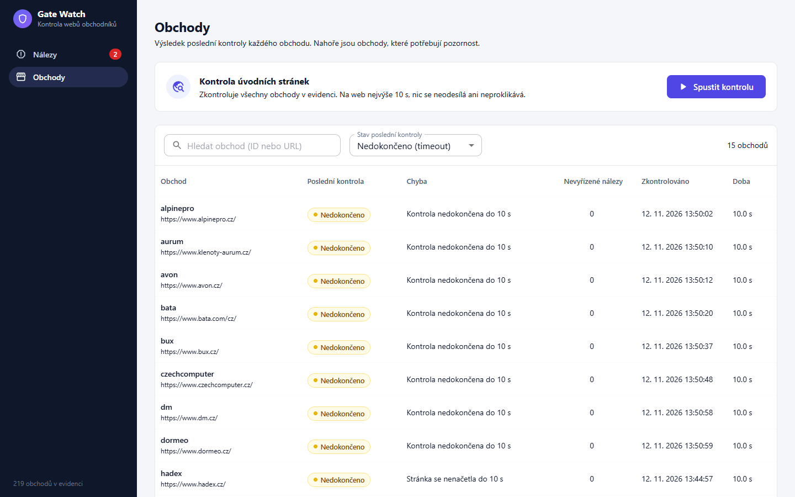
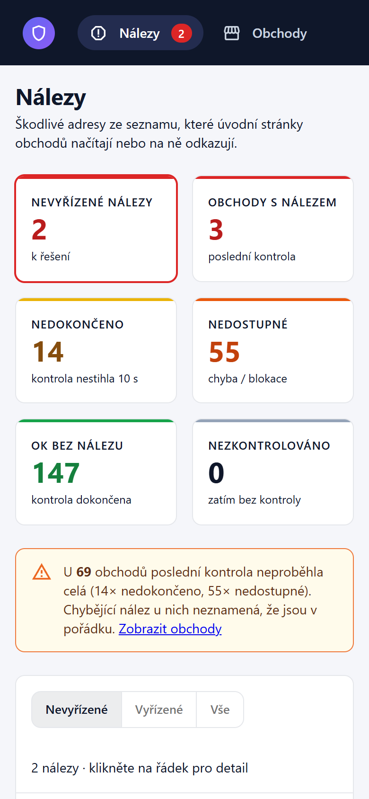
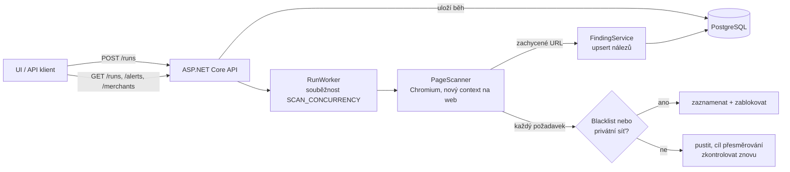
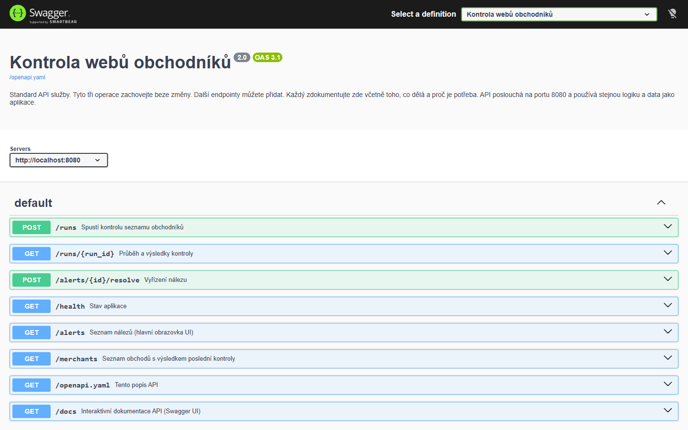
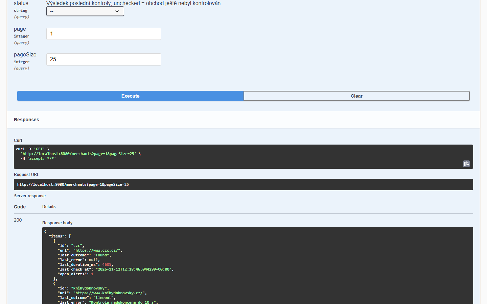

# Gate Watch – kontrola webů obchodníků

Gate Watch hlídá úvodní stránky e-shopů. U každého obchodu otevře v izolovaném prohlížeči jen úvodní stránku, zachytí vše, co stránka skutečně načte nebo kam vede, a porovná to s blacklistem škodlivých adres (URLhaus). Kolega, který s aplikací pracuje každý den, rychle uvidí, kde je problém, co přesně se našlo a proč, nález vyřídí s poznámkou a vyřízený nález ho při další kontrole už netrápí. Každá nová adresa je naopak nový nevyřízený nález.



**Spuštění jedním příkazem:** `docker compose up --build` a pak <http://localhost:8080>

---

## Obsah

- [Co aplikace umí](#co-aplikace-umí)
- [Spuštění](#spuštění)
- [Jak s aplikací pracovat](#jak-s-aplikací-pracovat)
- [Screenshoty](#screenshoty)
- [Jak funguje kontrola](#jak-funguje-kontrola)
- [API](#api)
- [Blacklist](#blacklist)
- [Testy](#testy)
- [Výsledky měření](#výsledky-měření)
- [Řešení problémů](#řešení-problémů)
- [Vývoj](#vývoj)
- [Dokumentace a struktura](#dokumentace-a-struktura)

## Co aplikace umí

- **Kontrola úvodní stránky** v headless Chromiu (Playwright). Zachytí síťové požadavky (skripty, styly, iframy, obrázky, XHR) včetně těch, které vzniknou až z JavaScriptu, celý řetěz přesměrování a z DOM `a[href]`, `form[action]` a `iframe[src]`. Adresa jen napsaná v textu nebo v komentáři nálezem není.
- **Bezpečně:** adresy z blacklistu se nikdy nenavštíví, ani jako cíl přesměrování; požadavek se zaznamená a zablokuje dřív, než odejde. Blokují se i privátní a lokální sítě. Na nic se neklikne, nic se neodešle, každý web dostane nový context prohlížeče a celá kontrola běží v Dockeru.
- **Limit 10 s na web.** Nedokončená nebo nedostupná kontrola **nikdy nevypadá jako „bez nálezu“**: v API má stav `error`, v UI žlutou nebo oranžovou barvu a nahoře je upozornění.
- **Nálezy, které nepřidělávají práci:** stejný obchod a stejná URL jsou pořád tentýž nález, takže vyřízení i poznámka zůstanou. Nová URL je nový nevyřízený nález. Stejná URL u jiného obchodu je samostatný nález.
- **UI pro každodenní práci:**
  - přehled stavů,
  - seznam nálezů s detailem (co, kde, se kterým záznamem blacklistu a z jakého zdroje),
  - vyřízení jedním klikem,
  - přehled obchodů seřazený podle toho, co potřebuje pozornost,
  - spuštění kontroly s průběhem.
- **Všechno přežije restart:** data jsou v PostgreSQL a přerušený běh se při startu poctivě označí jako `failed`.
- **API podle [openapi.yaml](openapi.yaml)** se stejnými daty a logikou jako UI.

## Spuštění

Potřebujete jen **Docker s Compose** (a git pro stažení repozitáře). Na hostiteli musí být volný **port 8080**.

1. Stáhněte repozitář a přejděte do jeho složky:

```bash
git clone https://github.com/BartosStore/gate-watch.git
```

```bash
cd gate-watch
```

2. Sestavte a spusťte aplikaci i databázi:

```bash
docker compose up --build
```

3. Otevřete <http://localhost:8080>.

Pokud je port 8080 obsazený, změňte v `docker-compose.yml` u služby `app` levou část mapování, třeba `"8081:8080"`, a aplikace pak poběží na <http://localhost:8081>. UI i API fungují na novém portu beze změny. Jen „Try it out“ ve Swagger UI volá adresu ze `servers` v závazném `openapi.yaml` (`http://localhost:8080`), takže pro zkoušení API přes Swagger nechte aplikaci na portu 8080.

| Co | Kde |
|---|---|
| UI i API | <http://localhost:8080> |
| Stav aplikace a blacklistu | <http://localhost:8080/health> |
| Dokumentace API (Swagger UI) | <http://localhost:8080/docs> |
| Popis API | [openapi.yaml](openapi.yaml), za běhu i na <http://localhost:8080/openapi.yaml> |

- První build stáhne image s Chromiem, takže trvá několik minut. Další buildy jsou rychlé.
- Při prvním startu se do databáze nahraje **219 skutečných českých e-shopů** z `data/merchants-sample.json` a blacklist. Dokud se blacklist načítá (pár sekund), spuštění kontroly vrací 503.
- Data jsou ve volume `pgdata` a přežijí restart. Všechna data smaže `docker compose down -v`.
- Souběžnost kontrol nastavuje proměnná `SCAN_CONCURRENCY` v `docker-compose.yml` (výchozí 8).

## Jak s aplikací pracovat

1. **Obchody → Spustit kontrolu.** Zkontrolují se všechny obchody v evidenci a průběh je vidět v reálném čase. 219 obchodů trvá asi 3–4 minuty.
2. **Nálezy** jsou úvodní obrazovka. Souhrnné karty ukazují, kolik je nevyřízených nálezů a u kolika obchodů kontrola neproběhla celá. Kliknutím na kartu se otevře seznam s odpovídajícím filtrem.
3. **Klik na nález** otevře detail: celou škodlivou adresu s kopírováním, typ prvku a co znamená, úvodní stránku obchodu, shodu s blacklistem a jeho zdroj, kdy byla adresa poprvé a naposledy viděna.
4. **Vyřídit:** volitelná poznámka a jedno kliknutí. Nález se přesune mezi vyřízené a při dalších kontrolách už nepřibude znovu. K vyřízeným se lze kdykoli vrátit (filtr „Vyřízené“ nebo „Všechny nálezy obchodu“).

## Screenshoty

| | |
|---|---|
| **Detail nálezu a vyřízení**<br> | **Vyřízený nález s poznámkou**<br> |
| **Obchody seřazené podle priority**<br> | **Probíhající kontrola**<br> |
| **Filtr: nedokončené kontroly**<br> | **Mobilní zobrazení**<br> |

Barvy stavů jsou všude stejné: 🔴 nalezeno / nevyřízeno · 🟡 nedokončeno (timeout) · 🟠 nedostupné · 🟢 OK · ⚪ nezkontrolováno / vyřízeno. Timeout a nedostupné nejsou nikdy zelené.

## Jak funguje kontrola



- Každá URL projde **jednou sdílenou normalizací**: absolutní adresa, jen http(s), malá písmena ve schématu a hostu, bez výchozího portu a fragmentu, prázdná cesta `/`, dotaz zůstává. S blacklistem se porovnává **přesná shoda**.
- **Nález = (obchod, normalizovaná URL).** ID je prvních 32 znaků SHA-256 z `merchant_id + "\n" + url` a je stabilní napříč kontrolami. Zápis jde přes `INSERT … ON CONFLICT (merchant_id, url) DO UPDATE SET last_seen_at`, takže kontrola nikdy nepřepíše vyřízení ani poznámku.
- Podrobnosti, rozhodnutí a model hrozeb jsou v [docs/PREDPOKLADY.md](docs/PREDPOKLADY.md).

## API

Závazný popis je v [openapi.yaml](openapi.yaml). Tři povinné operace jsou beze změny a přidané endpointy jsou v tomtéž souboru i s vysvětlením.

**Interaktivní dokumentace (Swagger UI): <http://localhost:8080/docs>**. Zobrazuje přímo `openapi.yaml` z repozitáře (servírovaný beze změny na `/openapi.yaml`), takže je vždy stejná jako závazný popis. Přes „Try it out“ jde každou operaci rovnou zavolat proti běžící aplikaci se stejnými daty jako v UI. Swagger UI je součástí aplikace (NuGet balíček) a nic nestahuje z internetu.

| | |
|---|---|
| **Přehled operací**<br> | **„Try it out“: živé volání `GET /merchants`**<br> |

| Metoda | Cesta | Popis |
|---|---|---|
| `POST` | `/runs` | Spustí kontrolu seznamu obchodů a hned vrátí `202 {run_id}` (i pro 20 000 obchodů do 5 s). `400` při špatném vstupu, `503` dokud se načítá blacklist. |
| `GET` | `/runs/{run_id}` | Průběh a výsledky (`running`, `done`, `failed`). `404` pro neznámé id. |
| `POST` | `/alerts/{id}/resolve` | Vyřídí nález s poznámkou; je idempotentní. |
| `GET` | `/alerts` | *(přidáno)* Seznam nálezů pro UI: `resolved`, `merchant_id`, stránkování. |
| `GET` | `/merchants` | *(přidáno)* Obchody s poslední kontrolou: `search`, `status`, stránkování. |
| `GET` | `/health` | *(přidáno)* Stav DB a blacklistu. |
| `GET` | `/docs` | *(přidáno)* Swagger UI nad `openapi.yaml`. |
| `GET` | `/openapi.yaml` | *(přidáno)* Tento popis API beze změny. |

<details>
<summary>Příklady (bash a Windows PowerShell)</summary>

bash (Linux, macOS, Git Bash):

```bash
curl -X POST http://localhost:8080/runs -H "Content-Type: application/json" -d '{"merchants":[{"id":"czc","url":"https://www.czc.cz/"}]}'
```

```bash
curl http://localhost:8080/runs/<run_id>
```

```bash
curl -X POST http://localhost:8080/alerts/<id>/resolve -H "Content-Type: application/json" -d '{"note":"overeno"}'
```

Windows PowerShell (`curl` je tam alias pro `Invoke-WebRequest`):

```powershell
$run = Invoke-RestMethod -Method Post -Uri http://localhost:8080/runs -ContentType "application/json; charset=utf-8" -Body '{"merchants":[{"id":"czc","url":"https://www.czc.cz/"}]}'
Invoke-RestMethod "http://localhost:8080/runs/$($run.run_id)" | ConvertTo-Json -Depth 5
Invoke-RestMethod -Method Post -Uri http://localhost:8080/alerts/<id>/resolve -ContentType "application/json; charset=utf-8" -Body '{"note":"Ověřeno s obchodem"}'
```

Tělo požadavků musí být v UTF-8.
</details>

## Blacklist

Blacklist se při startu načte do databáze i do paměti. Stav ukazuje `GET /health` (`blacklist_ready`, `blacklist_entries`).

- **URLhaus (abuse.ch)** dnes vyžaduje bezplatný Auth-Key; staré veřejné exporty vracejí 410 Gone. Pokud klíč máte, vložte do souboru `.env` vedle `docker-compose.yml` řádek `URLHAUS_AUTH_KEY=váš-klíč` a export se stáhne při startu. **Bez klíče se použije uložený snapshot** `data/urlhaus-snapshot.txt`.
- **Vlastní záznamy:** `data/blacklist-custom.txt`, jedna URL na řádek. Pro ukázku obsahuje neškodné skripty, které weby ze vzorku skutečně načítají, takže aplikace má co ukázat. Změny se projeví po `docker compose up --build`.

## Testy

Celá sada, tedy 106 testů včetně testů s Chromiem, integračních testů nad PostgreSQL a HTTP testů celé aplikace, běží v kontejneru. Příkaz funguje v PowerShellu, cmd i bashi:

```bash
docker compose run --rm --build tests
```

Testy ověřují hlavně pravidla zadání:
- stejný nález se po druhé kontrole nezdvojí a zůstane vyřízený,
- nová URL vytvoří nový nález,
- stejná URL u jiného obchodu je samostatný nález,
- timeout nevrací čisté `ok`,
- vyřízení je idempotentní,
- blacklistovaná adresa se nestáhne ani přes přesměrování,
- adresa v komentáři nebo textu nálezem není,
- privátní síť se blokuje,
- aplikace se obnoví po pádu prohlížeče,
- přes HTTP mají tři povinné operace přesně tvar odpovědí podle `openapi.yaml` a `/openapi.yaml` i Swagger UI na `/docs` fungují.

Testy používají samostatnou databázi `gatewatch_test`, takže data aplikace zůstanou netknutá. Rychlé unit testy jdou spustit i na hostiteli: `dotnet test` (testy s prohlížečem a DB se přeskočí).

## Výsledky měření

Podrobně v [docs/VYSLEDKY.md](docs/VYSLEDKY.md). Měřeno na 219 skutečných českých e-shopech:

| | Souběžnost 4 | Souběžnost 8 |
|---|---|---|
| Celkem 219 webů | 243 s | 193 s |
| Průměr na web | 4,4 s | 6,7 s |
| Dokončeno OK | 66 % | 50 % |

**Odhad pro 20 000 e-shopů:** asi 6 h na jedné instanci s 8 vCPU, nebo asi 1,5 h na čtyřech instancích. Spotřeba je asi 28 CPU-hodin, tedy zhruba **$1–2 za kompletní běh** (Hetzner, AWS).

## Řešení problémů

<details>
<summary><b>Windows: <code>failed to execute bake: exit status 1</code></b></summary>

Tuto chybu hlásí Docker Compose 5 s buildx 0.38, když je složka v příkazové řádce zapsaná s malým písmenem disku (`c:\dev\…`). Buildx pak bere Dockerfile (`C:\dev\…\Dockerfile`) jako soubor mimo povolenou složku; v `docker --debug compose build` je vidět `pass "--allow=fs.read=Dockerfile"`. Řešení: přejděte do složky s velkým písmenem disku, nebo jednorázově vypněte tuto kontrolu buildx.

```bash
cd /d C:\dev\cs\gate-watch
```

```bash
set BUILDX_BAKE_ENTITLEMENTS_FS=0
```

V PowerShellu (`$env:BUILDX_BAKE_ENTITLEMENTS_FS="0"`) a Git Bashi se problém obvykle neprojeví.
</details>

<details>
<summary><b>Po startu se nedá spustit kontrola (503)</b></summary>

Aplikace ještě načítá blacklist. Za pár sekund to zkuste znovu; stav ukazuje <http://localhost:8080/health>.
</details>

<details>
<summary><b>Chci začít s prázdnou databází</b></summary>

`docker compose down -v` a pak `docker compose up --build`. Smaže všechna data včetně vyřízených nálezů.
</details>

## Vývoj

Kontrola jedné nebo více stránek z příkazové řádky. Vypíše zachycené adresy, jejich typ, blokované požadavky a shody s blacklistem a nepotřebuje DB:

```bash
docker compose run --rm --no-deps app scan https://www.czc.cz/
```

Lokální vývoj bez Dockeru pro aplikaci (.NET 10 SDK a Node 24). Postgres je potřeba zpřístupnit na `localhost:5432`, například přes `docker-compose.override.yml`:

```bash
dotnet run --project src/Api
```

```bash
cd frontend && npm install && npm run dev
```

Vite dev server přeposílá volání API na `http://localhost:8080`.

## Dokumentace a struktura

| Soubor | Obsah |
|---|---|
| [docs/PREDPOKLADY.md](docs/PREDPOKLADY.md) | Předpoklady a rozhodnutí: identita nálezu, normalizace, shoda s blacklistem, mapování stavů, timeout s nálezem, restart, **model hrozeb**, otevřené body |
| [docs/VYSLEDKY.md](docs/VYSLEDKY.md) | Které weby se skenovaly, změřená čísla, odhad doby a nákladů, co se povedlo a co ne |
| [docs/ZADANI.md](docs/ZADANI.md) | Původní zadání |
| [openapi.yaml](openapi.yaml) | Popis API, za běhu interaktivně na `/docs` (Swagger UI) |

```
src/Api/            ASP.NET Core minimal API, EF Core (PostgreSQL), Playwright
  Blacklist/        import URLhaus / snapshot / vlastní záznamy, blacklist v paměti
  Scanning/         PageScanner (Chromium), blokace privátních sítí, příkaz scan
  Findings/ Runs/   nálezy (upsert, vyřízení), běhy a worker na pozadí
  Merchants/        seznamy pro UI, seed vzorku
  Domain/           normalizace URL, ID nálezu
tests/Api.Tests/    xUnit: unit, integrační (PostgreSQL) a testy s Chromiem
frontend/           React + Vite + TypeScript + MUI; build jde do src/Api/wwwroot
data/               vzorek e-shopů, snapshot URLhaus, vlastní záznamy blacklistu
docs/               dokumentace a screenshoty
```

**Technologie:** .NET 10 · ASP.NET Core · EF Core · PostgreSQL 17 · Microsoft Playwright (Chromium) · React 19 · Vite · MUI · TanStack Query · Docker Compose

---

Developed by [Miroslav Bartoš](https://bartosdev.cz)
